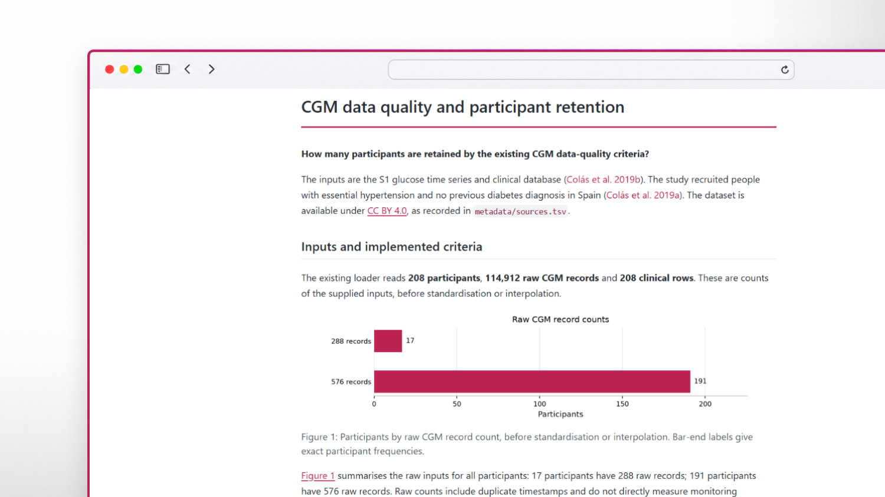

# Reproducible CGM Analysis

[](https://github.com/CrisCorreaS/capstone_repo/actions/workflows/reproduce.yml) [](pixi.toml) [](LICENSE) [](https://github.com/CrisCorreaS/capstone_repo/issues)

For my capstone in *The Art of Reproducible and Open Science*, I made [Martin Rivero’s CGM analysis](https://github.com/martinrivero15/cgm-variability-analysis) reproducible with a locked environment, verified downloads, configurable execution and a Quarto report.

The analysis draws on [Colás et al. (2019)](https://doi.org/10.1371/journal.pone.0225817). Regenerating this implementation does not establish full replication of the paper or independent scientific validation.

## Hardware and software requirements

Install [Git](https://git-scm.com/downloads) and [Pixi](https://pixi.prefix.dev/#installation). Pixi supplies Python, Quarto and the dependencies recorded in [pixi.lock](pixi.lock).

Reproduction is tested in CI on Windows x86-64, Linux x86-64 and macOS Intel and Apple Silicon. You can run the analysis locally on the supported platforms without a GPU. You’ll need an internet connection to install the environment and download the data.

> [!IMPORTANT]
> On Windows, the system temporary-directory path must contain only ASCII characters.

## Reproduce

Open a terminal where you want to keep the project:

```
git clone https://github.com/CrisCorreaS/capstone_repo.git
cd capstone_repo
pixi install --locked
pixi run --locked reproduce
```

This downloads and verifies the data, executes both notebooks, checks the outputs and renders the report. Subsequent runs replace recognised generated CSVs. Diagnostic log locations are printed in the terminal.

Open `reports/cgm-report.html` in your browser. Successful [CI runs](https://github.com/CrisCorreaS/capstone_repo/actions/workflows/reproduce.yml) also retain reports and tables as platform-specific artefacts for seven days.

## Expected outputs and report

The verified baseline for the **default configuration** is **208 participants**, **114,912 raw records** and **114 retained participants (54.8%)**.

With these settings, `pixi run --locked reproduce` produces **118 CSVs**: 114 interpolated participant files named `data/processed/interpolated/case_<id>.csv`, `data/processed/quality_summary.csv` and three tables under `results/tables/`: `metrics_summary.csv`, `final_dataset.csv` and `group_comparison.csv`. The CSV total can change with valid configuration choices.

The self-contained Quarto report demonstrates one result of the workflow: **How many participants are retained by the existing CGM data-quality criteria?** It presents retention counts, classifications and a horizontal bar chart of participants by raw record count. Raw counts include duplicate timestamps and do not measure monitoring duration. See the [report source](reports/cgm-report.qmd) and metadata below for methodological limitations.

[](assets/cgm-report-preview.png)

*Preview of the Quarto report with the default configuration.*

## Tasks and configuration

Run individual tasks as `pixi run --locked <task>` from the repository root:

| Task | Behaviour |
| --- | --- |
| `download-data` | Acquire or verify raw inputs and protect them as read-only. |
| `analyse` | Verify existing raw inputs and execute both notebooks; no download or report. |
| `check-outputs` | Check raw totals and expected CSV paths without changing files. |
| `report` | Render the report using existing raw inputs and analysis outputs. |
| `quarto` | Run Quarto through the project launcher. |

[config/analysis.toml](config/analysis.toml) controls quality thresholds and windows, entropy and DFA settings, gap detection and notebook timeouts. Rerun reproduction after changing settings. Saved outputs do not record which settings were used.

## Repository contents

| Location | Contents |
| --- | --- |
| `src/` | Data loading, acquisition, analysis utilities and execution tools. |
| `notebooks/` | Data exploration followed by metrics analysis. |
| `config/` | Analysis and execution settings. |
| `metadata/` | Provenance, checksums, participant mapping and variable definitions. |
| `reports/` | Quarto source and bibliography; generated HTML after rendering.
| `tests/`| Automated checks for data acquisition and Quarto execution. |
| `data/raw/` | Downloaded original inputs. |
| `data/processed/` | Generated participant CSVs and quality summary. |
| `results/tables/` | Generated analysis tables. |

## Data availability

The public S1 dataset, *Glucose time series and clinical database* ([DOI: 10.1371/journal.pone.0225817.s001](https://doi.org/10.1371/journal.pone.0225817.s001)), is distributed under CC BY 4.0. Raw files are downloaded, verified and kept read-only. Raw data and generated analysis outputs are excluded from version control.

Consult the [source records](metadata/sources.tsv), [expected checksums](metadata/checksums.sha256), [participant mapping](metadata/samples.tsv) and [data dictionary](metadata/data_dictionary.md).

## Licensing

Code and code blocks remain under the [MIT licence](LICENSE), preserving “Copyright (c) 2026 Martin Rivero”. New general repository documentation, including this README, uses the same licence. Inherited documentation retains its existing terms and attribution.

Original report prose and original figures contributed by this fork are licensed under [CC BY 4.0](https://creativecommons.org/licenses/by/4.0/), crediting Cristina Correa Segade. This declaration leaves inherited and third-party licences and attribution unchanged; the software licence does not apply to the source dataset.

## Citation and contact

Use [CITATION.cff](CITATION.cff) to cite this software. A test archive of the Windows-only v0.1.0 release is available on [Zenodo Sandbox](https://sandbox.zenodo.org/records/637660).

You can reach me through [GitHub issues](https://github.com/CrisCorreaS/capstone_repo/issues). For reproduction problems, use the [reproducibility form](https://github.com/CrisCorreaS/capstone_repo/issues/new?template=reproducibility_problem.yml). Read [CONTRIBUTING.md](CONTRIBUTING.md) and [CODE_OF_CONDUCT.md](CODE_OF_CONDUCT.md) before participating.